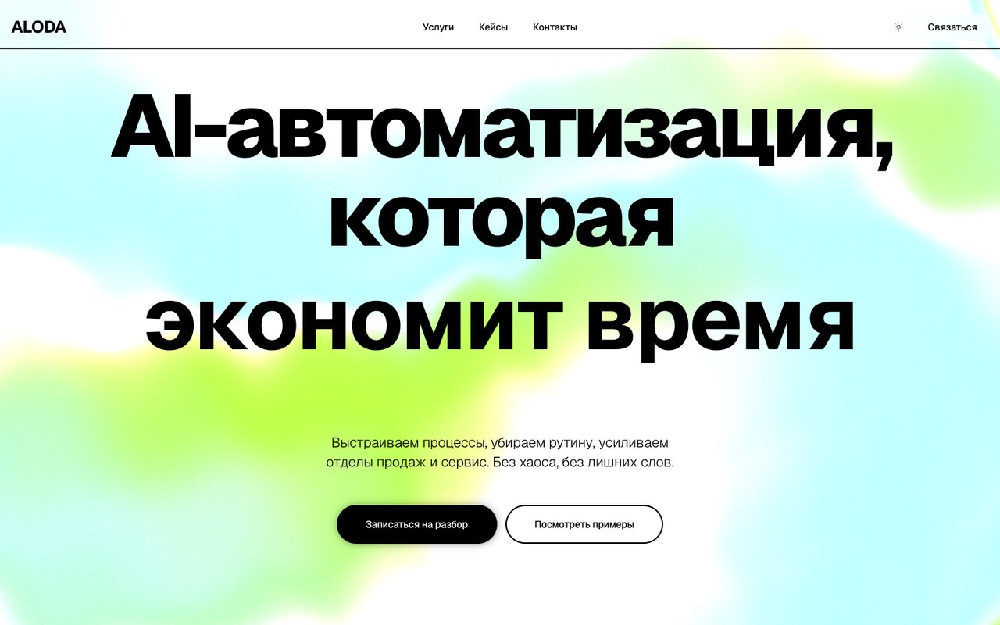
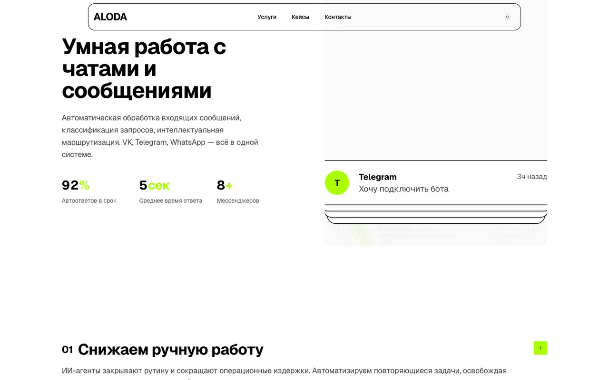
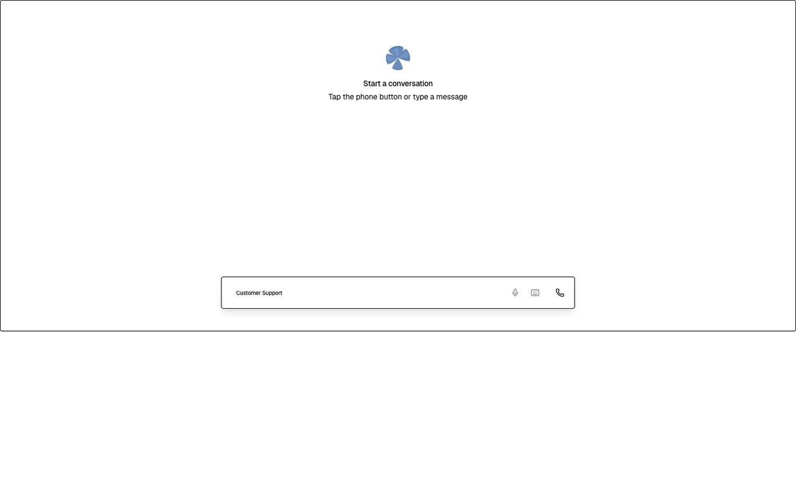
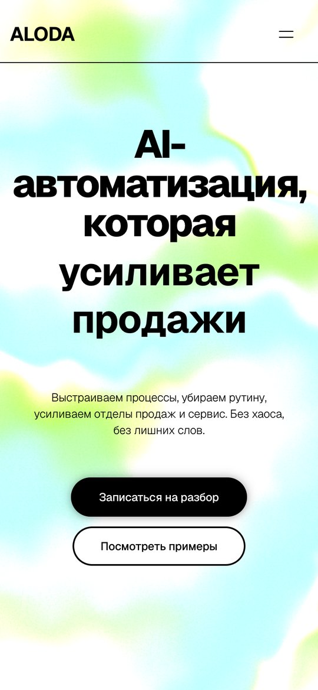
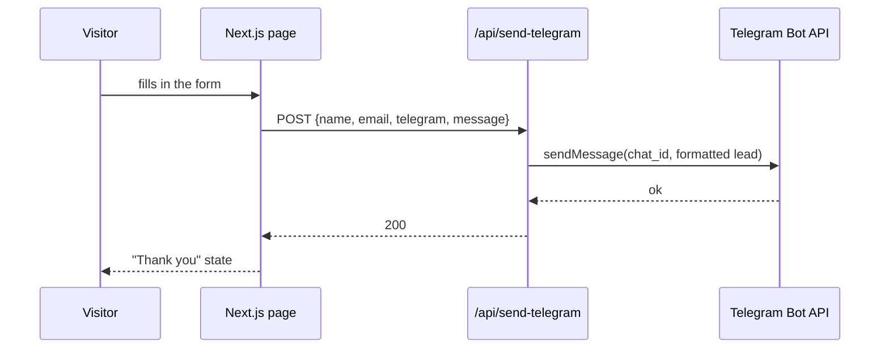

# ALODA — AI automation agency website (Next.js)

The website of ALODA, an agency that automates sales, customer support and internal processes with AI agents. Built with Next.js 16 and React 19: an animated hero with a shader background, a chat-automation showcase with live metrics, service blocks, FAQ, a lead form that delivers requests to Telegram, and a **live voice-agent demo** powered by ElevenLabs.



## Screens

| Chat automation section | Voice agent demo |
|:---:|:---:|
|  |  |

<p align="center"></p>

## Features

- **Hero** with an animated gradient-mesh / shader background (three.js) and a kinetic headline
- **Chat automation showcase** — animated message feed and metrics (auto-replies on time, average response time, number of messengers)
- **Services** — reduce manual work, boost sales, remove chaos from processes, connect tools
- **Voice agent** (`/voice-chat`) — talk to an AI voice assistant right in the browser via the ElevenLabs React SDK
- **Stats page** (`/stats-01`)
- **Lead form** — name, email, Telegram handle and request are forwarded to a Telegram chat by an API route
- Light / dark theme switch, Motion animations, shadcn/ui components

## Lead flow



## Project structure

```
src/app/page.tsx                 — landing page
src/app/voice-chat/page.tsx      — ElevenLabs voice agent demo
src/app/stats-01/page.tsx        — stats page
src/app/api/send-telegram/       — lead delivery to Telegram
src/components/                  — hero, header, accordion, book-demo, conversation demo,
                                   particle circle, shader, theme switch
src/components/ui/               — shadcn/ui + Magic UI components (orb, ripple, number ticker…)
nginx/, certbot/, docker-compose*.yml, Dockerfile — production deployment
```

## Tech stack

Next.js 16 (App Router), React 19, TypeScript, Tailwind CSS, shadcn/ui, Motion, three.js, ElevenLabs React SDK, Docker, nginx, Certbot.

## Getting started

```bash
npm install
npm run dev        # http://localhost:3000
```

The lead form needs a Telegram bot token and a chat ID: set `TELEGRAM_BOT_TOKEN` and `TELEGRAM_CHAT_ID` in `src/app/api/send-telegram/route.ts` (moving them to environment variables is recommended).

## Deployment

```bash
docker compose -f docker-compose.prod.yml up -d --build
./setup-ssl.sh                 # Let's Encrypt certificates via Certbot
```

See [`DOCKER_DEPLOY.md`](DOCKER_DEPLOY.md) and [`SERVER_SETUP.md`](SERVER_SETUP.md).
